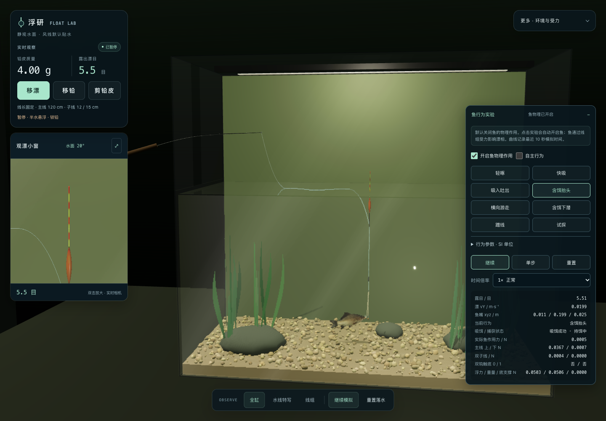
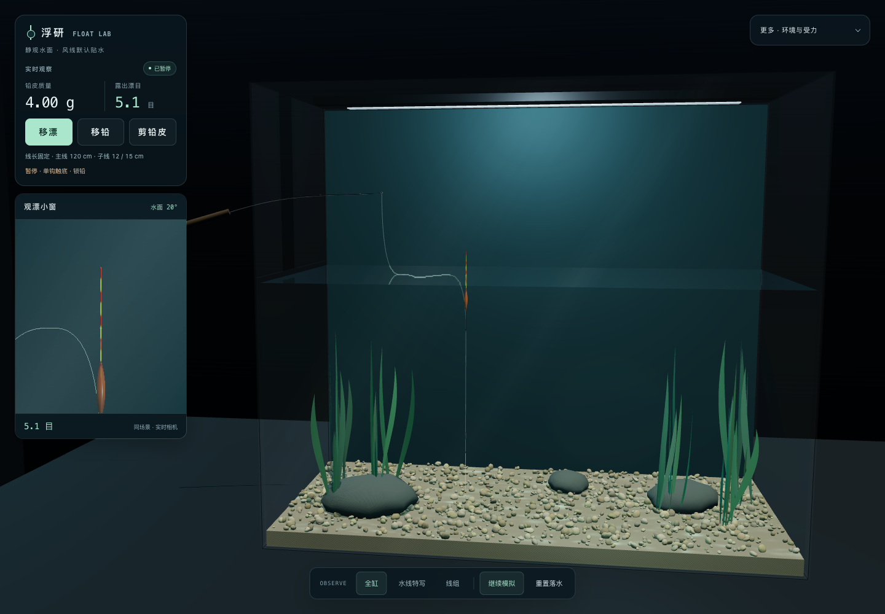
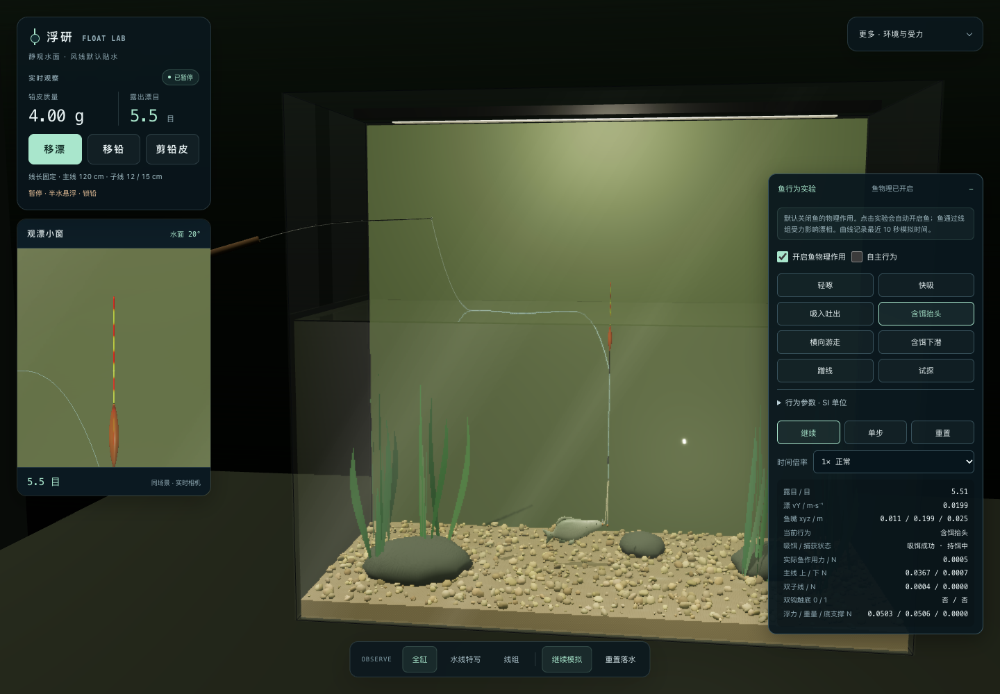

# 浮研 FLOAT LAB · 调漂观察室

> 浏览器里离线运行的 3D 台钓（台湾钓法）浮漂物理实验室：真实轮廓浮漂、完整线组、玻璃缸光学场景，以及基于摄影扫描鲫鱼的鱼口行为与漂相实验。

[](LICENSE)
[](#测试)
[](#快速开始)



## 这是什么

`FLOAT LAB` 是一个**教学与实验用的**浮漂物理沙盒，不是「按按钮播放预制漂相」的动画，也不是室外钓场模拟器。页面把一根 120 cm 主线、两根 12/15 cm 子线、浮漂、铅皮座、八字环和双钩饵放进玻璃缸，用固定步长的物理求解器推进，再让一只真实的鲫鱼扫描模型通过线组施力，观察浮漂露目、张力与姿态如何变化。

- 所有计算在浏览器本地完成，**无后端、无 CDN、无运行时下载**；打包后是单个 `index.html`，`file://` 双击即可打开。
- 鱼只对鱼钩节点输出牛顿力（或对张紧子线输出接触等效力），模型、行为与 UI **不能直接设置浮漂坐标**，也不会播放预设的顿口/送漂/黑漂动画。
- 物理是明确的工程近似（PBD + 只拉约束 + 经验阻尼），不是 CFD，也不是实钓标定。

## 功能

- **完整台钓线组**：固定竿尖 → 风线 → 漂座 → 主线 → 铅皮座/铅卷 → 独立八字环 → 长短双子线 → 钩与饵；移漂座、移定位豆只重新分配材料长度，不重新裁线。
- **六节点 PBD 求解**：漂脚、漂尖、铅座、八字环、双钩；子步不超过 `1/240 s`，每步 24 次约束迭代；线只拉不推，含床面非穿透、风线水面承托、锁铅/限定行程跑铅。
- **真实浮漂轮廓**：几何与物理共用同一条回转曲线，按浸水体积积分排水与浮力，浮漂可倾斜、侧躺，露目由实际平衡决定；支持调漂、重铅找底、剪铅、改饵重/钩重。
- **玻璃缸与光学**：同一场景的双相机「观漂小窗」（与主视图共享物理快照）、水面折射/反射、深度散射与清澈度调节，桌面与手机视口适配。
- **鲫鱼行为实验**：基于 ffish.asia 银鲫摄影扫描（约 18 cm、19,900 三角面）；巡游/发现/接近/观察/吸饵/吐饵/抬头/含饵游动/蹭线/逃离十态状态机；八种手动实验（轻啄、快吸、吸入吐出、含饵抬头、横向游走、含饵下潜、蹭线、试探）；固定种子可复现、暂停/单步/慢放、最近 10 s 露目与事件曲线。
- **整鱼接触近似**：以扫描高模与渲染网格构建保守碰撞包络，包含连续摆尾扫掠；鱼嘴取真实口缘顶点质心，与物理嘴位置对齐。
- **60 FPS 性能目标**：固定物理步长与精度不降级；单文件网页按阶段解压/执行并显示真实阶段，预稳定分片让出主线程，砂石高度场离线烘焙为同源缓存，重复阴影/反射错峰复用。
- **可验证**：纯 Node 单元测试 + Chrome CDP 桌面/手机视口回归，实验记录与验收报告随仓库提供。

<table>
<tr>
<td width="50%"></td>
<td width="50%"></td>
</tr>
</table>

## 快速开始

### 方式一：直接打开（无需构建、无需联网）

下载/克隆仓库后，用现代浏览器打开根目录的 `index.html`：

```sh
git clone https://github.com/ZouQi523/fishingFloat.git
cd fishingFloat
open index.html        # macOS；Windows 可直接双击，Linux 用 xdg-open index.html
```

要求浏览器支持 **WebGL2** 与 gzip `DecompressionStream`（Chrome/Edge 80+、Firefox 113+、Safari 16.4+）。

### 方式二：从源码重新构建单文件

```sh
python3 build.py
# 输出：index.html（约 5 MB；模块以确定性 gzip/base64 内嵌，含 three.js 与扫描模型）
```

只修改 `src/` 不会自动更新已构建的 `index.html`，需要重新执行 `python3 build.py`。

### 测试

```sh
node --test tests/*.test.cjs
```

纯 Node 单元测试不依赖 DOM、Three.js 或 Chrome，覆盖浮力、线组约束、锁铅/跑铅、风线水面承托、鱼行为状态机与固定种子确定性、整鱼接触等。

浏览器级检查（可选，需要本机 Chrome 以 `--remote-debugging-port=9334` 启动，Node 24）：

```sh
node browser-check.cjs --regression preview-updated.png
MOBILE=1 node browser-check.cjs --regression preview-mobile-regression.png
```

## 项目结构

```text
├── index.html            # 构建产物：可离线双击的单文件观察室（已提交，含内嵌资源）
├── index-2d.html         # 早期 2D 原型页面，独立保留
├── build.py              # 单文件构建脚本（内嵌 three.js + 模块 + 扫描模型）
├── src/                  # 物理 / 线组 / 鱼行为 / 光学 / UI 源码
├── vendor/               # 本地 three.js 与 OrbitControls（不依赖 CDN）
├── tests/                # Node 单元测试 + Chrome CDP 浏览器检查
├── tools/                # Blender 建模与扫描导入脚本
├── assets/               # 银鲫扫描资产、纹理与模型 QA 记录
├── baselines/            # 阶段基线快照与 SHA256 清单
├── docs/screenshots/     # README 截图
├── research/             # 立项调研资料（GitHub 同类项目实况核查）
├── PERFORMANCE.md        # 60 FPS 原则、离线加载与性能验证
├── PHYSICS.md            # 物理模型、参数与 API 说明
├── FISH_LAB_PLAN.md      # 鱼行为实验室实施与验收方案
├── FISH_LAB_GUIDE.md     # 操作指南与物理边界
└── FISH_LAB_ACCEPTANCE.md# 最终验收报告（模型、QA 与浏览器证据）
```

## 物理模型（摘要）

- 单位：m / m³ / s / kg / N；坐标 `y` 向上，默认水面 `y=0.83 m`、床面 `y=0.055 m`。
- 六节点 PBD，子步 `≤1/240 s`，每步 24 次约束迭代；线段只拉不推，床面接触带非弹性切向衰减。
- 浮漂按真实回转轮廓分片积分浸水体积，浮力与质量按轴向分布；可倾斜、侧躺，露目是求解结果而非目数反推。
- 风线以准静态弧线近似水面承托，水下松线用弧长搜索绘制；这些是受力近似，不是完整柔性线动力学。
- 鱼的唯一受力通道：钩节点外力 / 张紧子线接触等效力 → 子线 → 八字环 → 主线 → 浮漂；非法或非有限输入原子拒绝。
- 详细公式、默认参数、`TaiwanRig` API 与已知边界见 [PHYSICS.md](PHYSICS.md)。

## 文档

| 文档 | 内容 |
| --- | --- |
| [PERFORMANCE.md](PERFORMANCE.md) | 60 FPS 验收原则、分阶段离线加载、地形缓存与画质档位 |
| [PHYSICS.md](PHYSICS.md) | 物理权威、连续拓扑、默认参数、动力学、外力通道、API 与已知边界 |
| [FISH_LAB_PLAN.md](FISH_LAB_PLAN.md) | 鱼行为实验室的分阶段实施与验收方案 |
| [FISH_LAB_GUIDE.md](FISH_LAB_GUIDE.md) | 一次可复现的手动实验、参数对照、时间控制与读数 |
| [FISH_LAB_ACCEPTANCE.md](FISH_LAB_ACCEPTANCE.md) | 扫描模型、整鱼接触、Node/Chrome 验证证据与验收边界 |
| [assets/crucian-scan/README.md](assets/crucian-scan/README.md) | 银鲫扫描资产的来源、修改、QA 与复现步骤 |

## 测试与验证

- **纯 Node 单元测试**：`node --test tests/*.test.cjs`，当前 188 项通过（Apple Silicon macOS，Node 24）。
- **浏览器回归**：`browser-check.cjs` 连接本机 Chrome 调试端口，覆盖桌面/手机视口、工作台拖动、观漂相机、水体清澈度与鱼实验；运行记录见 `qa-*.log`、`preview-*.png/json`。
- **模型与资产 QA**：`assets/crucian-scan/` 下的 `geometry-qa.json`、`runtime-qa.json`、`glb-reimport-qa.json` 与独立校验脚本。

本仓库把上述实验记录一并保留，作为可复查的验收证据，而不是只保留结论。

## 许可

- **代码与文档**：[MIT](LICENSE)。
- **银鲫摄影扫描模型**：原作者 **ffish.asia / floraZia.com**，原作页面声明 CC0，历史下载元数据为 CC BY 4.0，本项目按 **CC BY 4.0** 保守署名并附修改说明，详见 [assets/crucian-scan/LICENSE.md](assets/crucian-scan/LICENSE.md)。
- **three.js / OrbitControls**：MIT。
- 完整第三方说明见 [THIRD_PARTY_NOTICES.md](THIRD_PARTY_NOTICES.md)。

## 边界与声明

本项目是**教学与实验用的物理近似**：不保证每种按钮都出现命名漂相，不替代实钓标定，也不构成钓具选型建议。扫描视觉网格不宣称水密；碰撞使用独立闭合保守包络。未覆盖的真实范围见 [FISH_LAB_ACCEPTANCE.md](FISH_LAB_ACCEPTANCE.md)。

---

## English summary

**FLOAT LAB** is an offline, single-file browser lab for the physics of a Taiwan-style fishing float rig: a six-node PBD solver (≤1/240 s substeps, tension-only constraints), a float shape integrated against real displaced volume, a glass-tank scene with in-scene optics, and a photo-scanned crucian carp whose ten-state behaviour applies real forces to the hooks to produce float responses. Everything runs locally with no network access. Code is MIT; the scanned fish model is used under CC BY 4.0 with attribution to ffish.asia / floraZia.com.
